<div align="center">
  
  &nbsp;&nbsp;&nbsp;&nbsp;&nbsp;
  

  # Redes.tf: da Teoria à Prática com Terraform e GCP

  **Kit do Participante — Minicurso Oficial e-info 2026 | FACAPE**
</div>

---

## Bem-vindo(a)!

Este repositório traz **tudo o que você precisa para o dia do minicurso**. O restante do material (slides, gabaritos de cada etapa etc.) será liberado **durante e depois da aula**. Nada de spoiler por aqui 😉

**Facilitador:** Luan Sousa, Cloud Engineer na SantoDigital (Parceira Google Cloud)

---

## O que tem aqui

```text
redes-tf-kit-alunos/
├── README.md                    # Este arquivo
├── pre-material/                # FAÇA ANTES DO CURSO
│   ├── README.md                # Guia passo a passo: ferramentas, login no GCP e validação
│   ├── conceitos-base.md        # Leitura de aquecimento (10 min)
│   └── foundation-check/        # Seu primeiro Terraform: valida o ambiente e gera seu Cartão de Foundation
└── terraform/
    └── live-coding/             # Pasta onde você vai construir tudo, do zero, durante a aula
```

---

## Antes do dia do curso (obrigatório)

1. Leia [`pre-material/conceitos-base.md`](./pre-material/conceitos-base.md).
2. Siga o guia [`pre-material/README.md`](./pre-material/README.md) até gerar o seu **Cartão de Foundation**.

Você vai precisar de duas informações da lista da turma enviada pelo facilitador:

| Parâmetro | O que é | Exemplo |
| :--- | :--- | :--- |
| **`student_id`** | Seu número único na turma (`1` a `40`). Define sua sub-rede exclusiva `10.<ID>.0.0/24`. | `7` → `10.7.0.0/24` |
| **`project_id`** | Projeto GCP do seu grupo. Grupo = `ceil(student_id / 4)`. | `einfo-redes-grupo-02` |

> [!TIP]
> **Não quer instalar nada?** Faça tudo pelo **Google Cloud Shell** ([shell.cloud.google.com](https://shell.cloud.google.com)), que já traz `terraform`, `gcloud`, `git` e um editor estilo VS Code.

---

## No dia do curso

Chegue com o repositório já clonado (na sua máquina ou no seu Cloud Shell) e o `foundation-check` já executado. Vamos trabalhar em [`terraform/live-coding/`](./terraform/live-coding/README.md).

Nos vemos lá! 🚀
