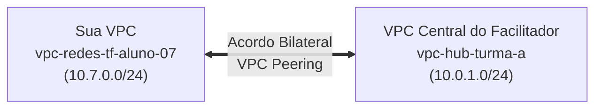

# Aquecimento Conceitual (Leitura de 10 minutos) — Redes.tf

Antes de colocarmos a mão na massa no dia do minicurso, este guia rápido resume os **5 conceitos fundamentais** que vamos transformar em código durante a aula. Não se preocupe em decorar nada: vamos revisar e construir cada um deles ao vivo!

---

## 1. O que é uma VPC (Virtual Private Cloud)?

Na faculdade, aprendemos que uma **Rede Local (LAN)** conecta computadores através de switches e roteadores físicos dentro de um prédio.
No **Google Cloud Platform (GCP)**, a **VPC** é a sua rede privada virtual definida por software (*SDN — Software-Defined Networking*):

- **A VPC no GCP é Global:** Diferente de outras nuvens onde uma VPC fica presa a uma única região geográfica, no Google Cloud uma única VPC pode conectar sub-redes nos Estados Unidos (`us-central1`), no Brasil (`southamerica-east1`) e na Europa através da fibra óptica privada da Google!
- **As Sub-redes (*Subnets*) são Regionais:** Dentro da VPC global, criamos "fatias" de endereços IP em regiões específicas (como `us-central1`).

---

## 2. Endereçamento IPv4 e Notação CIDR (`/24`)

Cada máquina virtual (VM) precisa de um endereço IP privado para conversar na rede. Nós definimos o tamanho de uma sub-rede usando a notação **CIDR** (ex: `10.7.0.0/24`):

- Um endereço IPv4 tem **32 bits**, divididos em 4 blocos (octetos) de 8 bits: `10` . `7` . `0` . `0`.
- O sufixo **`/24`** significa que os primeiros **24 bits (os 3 primeiros números: `10.7.0`)** são fixos e identificam **qual é a sub-rede**.
- Os **8 bits finais (o último número, de `.0` a `.255`)** ficam livres para identificar as máquinas dentro dessa sub-rede (**256 endereços possíveis**).

> [!NOTE]
> **Por que cada aluno usa `10.<student_id>.0.0/24` no minicurso?**  
> Quando duas redes diferentes precisam se conectar (via **VPC Peering** ou **VPN**), elas **nunca podem usar a mesma faixa de IPs** (caso contrário, o roteador não saberia para qual rede enviar o pacote!).  
> Ao usar seu `student_id` no segundo octeto:
> - **Aluno 01** usa `10.1.0.0/24` (endereços `10.1.0.0` a `10.1.0.255`; no GCP, as VMs usam `.2` a `.253`)
> - **Aluno 07** usa `10.7.0.0/24` (endereços `10.7.0.0` a `10.7.0.255`; no GCP, as VMs usam `.2` a `.253`)
> - **Hub Central do Facilitador** usa `10.0.1.0/24` e `10.0.2.0/24`  
> Assim, **todas as redes da sala podem se conectar ao mesmo tempo sem nenhum conflito!**

---

## 3. Firewall, Cloud IAP e Cloud NAT (Segurança em Nuvem)

Em ambientes corporativos reais, **colocar um IP público direto em todas as máquinas virtuais é um risco grave de segurança** (qualquer robô na internet tentará atacar a porta de SSH ou banco de dados).

Durante o curso, faremos do jeito profissional:
1. **VM 100% Privada:** Nossa máquina virtual nascerá **sem IP Público** (apenas com o IP interno `10.<ID>.0.2`).
2. **Cloud Firewall + Cloud IAP (Como entramos na VM?):** Usaremos o *Identity-Aware Proxy (IAP)* da Google, um túnel seguro que verifica sua identidade Google e entra na VM pela rede interna (`35.235.240.0/20`).
3. **Cloud NAT (Como a VM baixa pacotes da internet?):** Quando a VM privada precisar sair para a internet (para rodar `apt update` ou `curl`), o **Cloud NAT** traduzirá o IP privado dela para um IP público de saída (*SNAT*), sem permitir que ninguém de fora entre!

---

## 4. VPC Network Peering (Conectando Redes Distintas)

Por padrão, uma VPC é totalmente isolada de outra VPC.
O **VPC Network Peering** permite conectar duas VPCs (mesmo que estejam em projetos diferentes!) para que elas conversem usando apenas **IPs privados**, na velocidade da rede interna da Google e sem passar pela internet pública.



Para que o Peering funcione (fique com status **`ACTIVE`**), os dois lados precisam declarar que confiam um no outro:
1. Você declara no seu Terraform que sua VPC quer conectar na VPC do Facilitador.
2. O Projeto Central do Facilitador aceita a conexão apontando de volta para a sua VPC.
3. Automaticamente, as duas redes trocam suas **tabelas de rotas**!

---

## 5. O que é o Terraform (Infraestrutura como Código — IaC)?

Em vez de entrarmos no site do Google Cloud e clicarmos em dezenas de botões e formulários para criar VPC, sub-rede, firewall, roteador e NAT, nós escrevemos arquivos de texto na linguagem **HCL (HashiCorp Configuration Language)**:

```hcl
resource "google_compute_network" "minha_vpc" {
  name                    = "vpc-redes-tf-aluno-07"
  auto_create_subnetworks = false
}
```

E usamos 4 comandos principais no terminal:
- **`terraform init`**: Prepara a pasta e baixa o conector (*provider*) do Google Cloud.
- **`terraform plan`**: Simula o que será feito e mostra na tela o que será criado (`+`), alterado (`~`) ou destruído (`-`) **antes** de tocar na nuvem.
- **`terraform apply`**: Chama as APIs do Google Cloud, cria toda a infraestrutura em segundos e salva o registro no arquivo de estado (`terraform.tfstate`).
- **`terraform destroy`**: Remove de forma limpa e na ordem exata tudo o que foi criado.
